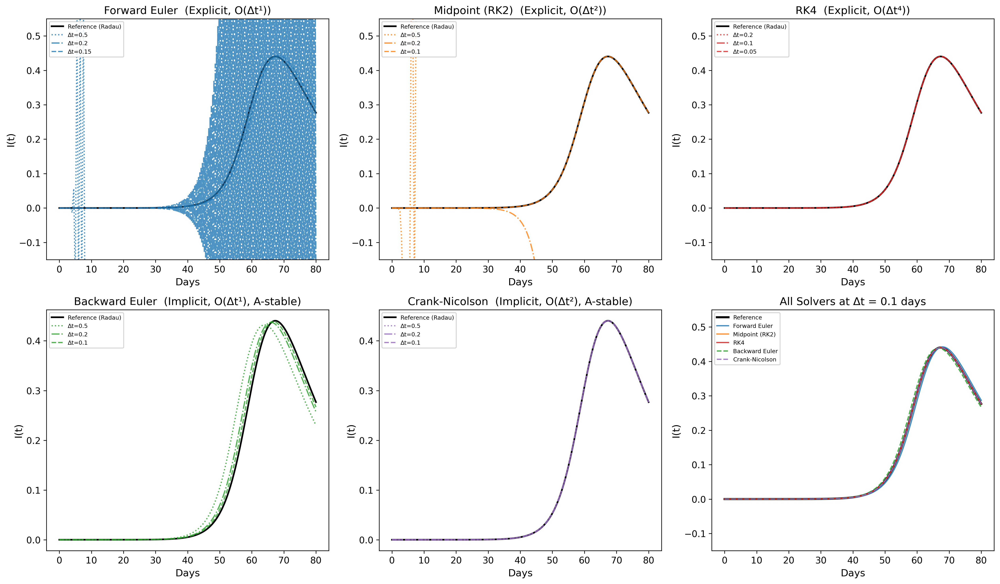
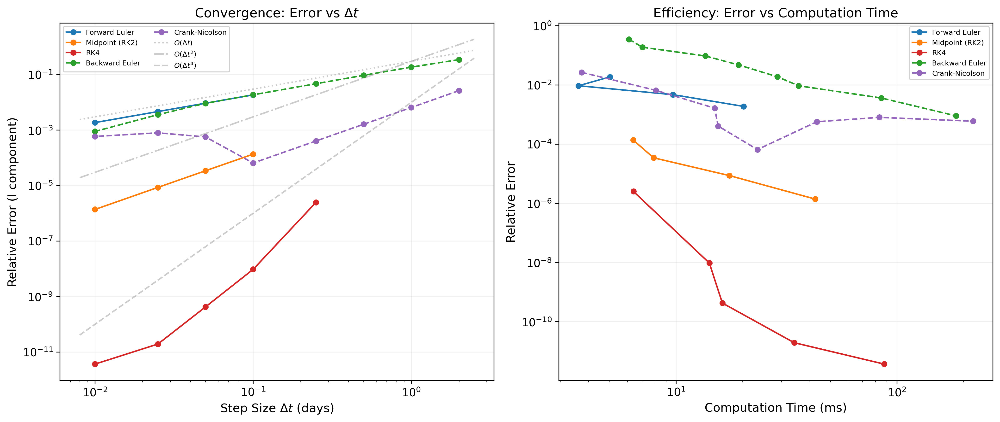
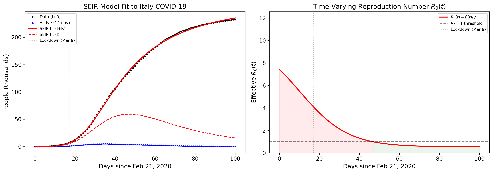
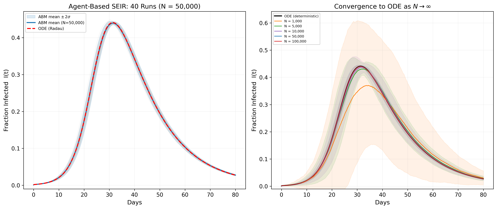

# Numerical ODE Solvers for a Stiff SEIR Epidemic Model

Course project for PHYS 3450 (Numerical Methods) at Seattle University.

I wrote five ODE solvers and compared how they handle a stiff SEIR epidemic model, looking at stability, accuracy and cost. I then fit a time-varying SEIR model to Italy's COVID-19 data (February to May 2020).

## Solvers

| Method | Type | Order |
|---|---|---|
| Forward Euler | explicit | 1 |
| Midpoint (RK2) | explicit | 2 |
| RK4 | explicit | 4 |
| Backward Euler | implicit (Newton's method) | 1 |
| Crank-Nicolson | implicit (Newton's method) | 2 |

All solvers share the signature `(rhs, t0, tmax, y0, dt, args=())`. Errors are measured against a SciPy Radau solution (rtol = 1e-12).

## Results

**Stability.** With a fast latency rate (sigma = 10) the SEIR system is stiff, with a stiffness ratio around 10^9. The explicit methods blow up at large step sizes, while the implicit methods stay stable.



**Convergence.** Log-log error plots match the expected order for each method.



**Fit to Italy.** I fit a SEIR model where the transmission rate changes smoothly from one value to another around the lockdown, using SciPy's differential evolution. The fit recovers the lockdown: R0 drops from about 2.28 to 0.86.



**Agent-based model.** `Agent2.py` runs a stochastic agent-based version of the same SEIR model and shows that it approaches the ODE solution as the population grows, with spread shrinking like 1/sqrt(N).



## Files

- `generate_figures.py` - solvers, SEIR model, stiffness analysis and the Italy fit (figures 1-5)
- `Agent2.py` - agent-based SEIR model and convergence to the ODE (figure 6)
- `StabilityProblems.py` - earlier homework on implicit Euler vs. RK4 stability (`problem1-5.png`)

## Running it

```
pip install numpy scipy pandas matplotlib
python generate_figures.py
python Agent2.py
```

`generate_figures.py` expects a `covid_data.csv` from [Our World in Data](https://catalog.ourworldindata.org/garden/covid/latest/compact/compact.csv) in the same folder.

Related: my [SIR model paper](https://github.com/Kyler-Kasravi/covid-sir-dynamics) from Nonlinear Systems, which showed why a constant-parameter model doesn't fit this data.
